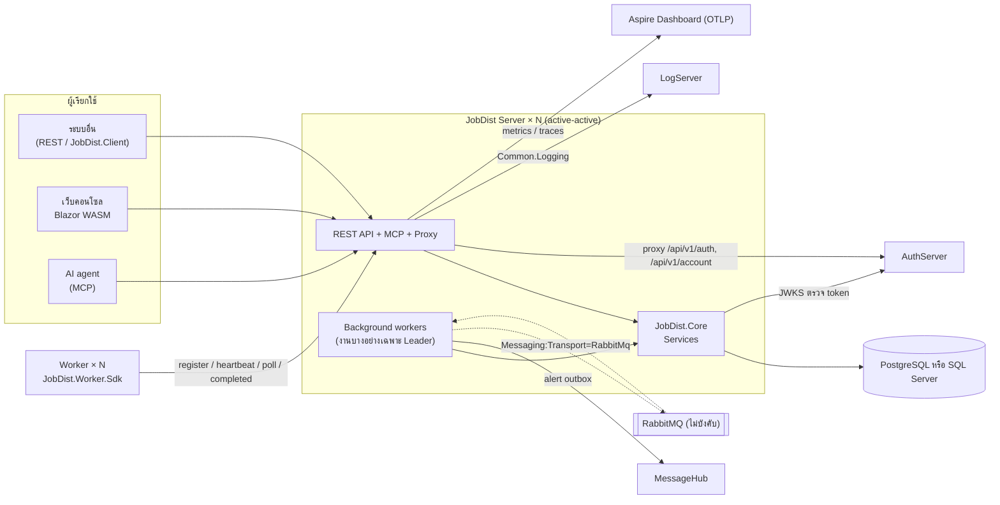
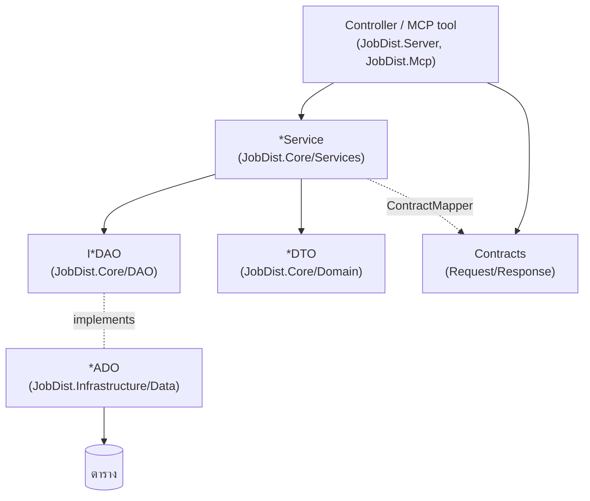

# JobDist: Architecture Design

เวอร์ชัน 2.0 · ปรับปรุง 27 พฤศจิกายน 2569 · อ้างอิงโค้ดใน `main`

เอกสารนี้อธิบายโครงสร้างของ JobDist ทั้งระบบ: ส่วนประกอบ, ชั้นของโค้ด, การทำงานแบบหลายเครื่อง (HA), ความปลอดภัย และการเชื่อมกับระบบอื่น
แผนภาพละเอียดอยู่ใน [ER Diagram](diagrams/ER_DIAGRAM.md), [Data Flow Diagram](diagrams/DATAFLOW.md) และ [Deployment Diagram](diagrams/DEPLOYMENT.md)
ส่วนความสัมพันธ์ หน้าจอ ↔ REST API ↔ Class ↔ Table อยู่ใน [TRACEABILITY.md](TRACEABILITY.md)

---

## 1. ภาพรวม

JobDist คือระบบจัดคิวและกระจายงาน (job scheduler) ไปยังเครื่องประมวลผล (Worker) หลายเครื่อง
ระบบอื่นส่งงานเข้ามา JobDist เลือก Worker ที่เหมาะสมที่สุดตามภาระ ความเร็ว และความน่าเชื่อถือที่เรียนรู้จากประวัติ
แล้วติดตามผล retry ย้ายงานเมื่อ Worker หาย และแจ้งเตือนผ่าน MessageHub

ธุรกิจชั้นเดียว (`JobDist.Core`) เปิดให้เรียกได้ 3 ทาง:

| ช่องทาง | ใช้โดย | จุดเข้า |
|---|---|---|
| REST API `/api/v1/*` | ระบบอื่น, เว็บคอนโซล, SDK | `JobDist.Server` (controllers) |
| MCP (Streamable HTTP `/mcp` หรือ stdio) | AI agent | `JobDist.Mcp`, `JobDist.McpServer` |
| .NET SDK | ระบบ .NET ที่ส่งงาน (`JobDist.Client`) และ Worker (`JobDist.Worker.Sdk`) | NuGet/โปรเจกต์อ้างอิง |

## 2. โปรเจกต์ในโซลูชัน (`JobDist.slnx`)

| โปรเจกต์ | ชั้น | หน้าที่ |
|---|---|---|
| `JobDist.Contracts` | สัญญา | DTO ที่ส่งผ่าน REST/SDK (`SubmitJobRequest`, `JobStatusResponse`, enum ต่าง ๆ) ไม่มี dependency |
| `JobDist.Core` | ธุรกิจ | Domain `*DTO`, interface `I*DAO`, business `*Service`, options, security, metrics |
| `JobDist.Infrastructure` | ข้อมูลและเชื่อมต่อ | `*ADO` (Dapper) ของ PostgreSQL/SQL Server/in-memory, background workers, MessageHub client, RabbitMQ, `UpstreamVersionMonitor` |
| `JobDist.Server` | Host | ASP.NET Core: controllers, auth (API key + AuthServer Bearer), rate limit, idempotency filter, YARP proxy, MCP endpoint, host เว็บคอนโซล |
| `JobDist.Web` | หน้าจอ | Blazor WebAssembly บน `WebCommon.UI` (DevExpress) ภาษาไทย/อังกฤษ |
| `JobDist.Mcp` | AI tools | `JobDistAiTools` (เครื่องมืออ่านอย่างเดียวและเครื่องมือที่มีผลข้างเคียง) |
| `JobDist.McpServer` | Host | MCP แบบ stdio อ่านฐานข้อมูลเดียวกับ server |
| `JobDist.Client` | SDK | `IJobDistClient` สำหรับระบบที่ส่งงาน (failover หลาย URL, idempotency key อัตโนมัติ) |
| `JobDist.Worker.Sdk` | SDK | `IJobHandler`, `JobDistWorkerService` สำหรับเครื่องที่ประมวลผล |
| `JobDist.ServiceDefaults` | Host | OpenTelemetry, health check `/health` และ `/alive` |
| `tools/JobDist.ApiExport` | เครื่องมือ | สร้าง `docs/API_EXPORT.md` และ `docs/api-export.json` จากโค้ด |
| `samples/*` | ตัวอย่าง | `JobDist.SampleWorker`, `JobDist.AiClientSample` |
| `external/common` | submodule | `Common.AspNetCore` (ตรวจ token AuthServer), `Common.Logging` (ส่ง log ไป LogServer) |
| `external/webcommon` | submodule | `WebCommon.UI` (template หน้าจอ, AppShell, AppGrid, การเข้าสู่ระบบ AuthServer) |

### 2.1 ชั้นของโค้ดและการตั้งชื่อ

- Controller ไม่เรียก DAO ตรง เรียกผ่าน `*Service` เท่านั้น
- `*ADO` ใช้ Dapper และ SQL ที่เขียนเองต่อ provider (`Database:Provider` = `PostgreSql` | `SqlServer`) มี in-memory provider สำหรับ test
- Schema อยู่ที่ `db/postgres/schema.sql` และ `db/sqlserver/schema.sql` (idempotent, รันตอนเริ่มเมื่อ `Database:AutoMigrate=true`)

## 3. Service หลักใน `JobDist.Core`

| Service | หน้าที่ |
|---|---|
| `JobService` | รับงาน (ตรวจข้อมูล, เข้ารหัส payload ที่ sensitive, ตรวจ idempotency, ตรวจเกณฑ์คิว), ค้นหา, เปลี่ยน priority, ยกเลิก |
| `SchedulerService` | จัดงานที่รอให้ Worker (effective priority + aging, คะแนน Worker แบบ SIMD/parallel) ทำงานบน Leader |
| `DispatchService` | ตอบ long-poll ของ Worker ส่งงานพร้อมลายเซ็น ML-DSA/ECDSA และ payload ที่เข้ารหัส |
| `JobExecutionService` | รับรายงาน started/completed, retry ตาม `RetryPolicyService`, บันทึก `jobattempts`, ส่งข้อมูลให้ model เรียนรู้ |
| `WorkerRegistryService` | ลงทะเบียน/ถอด Worker, heartbeat, drain, ส่งคำสั่ง (`workercommands`) |
| `FailoverService` | ตรวจ Worker ที่หาย (`OfflineAfterSeconds`) และงานที่ lease หมด แล้วคืนงานเข้าคิว (Leader) |
| `LeaderElectionService` | เลือก Leader ด้วย lease ในตาราง `leaderleases` พร้อม fencing `term` |
| `PerformanceLearningService` | เรียนรู้เวลาเฉลี่ย/ส่วนเบี่ยงเบน/อัตราสำเร็จต่อ Worker × ประเภทงาน |
| `JobRiskService` | ประเมินความเสี่ยงของงาน, การส่งงาน (what-if) และ Worker |
| `AnomalyDetectionService` + `AlertService` | ตรวจความผิดปกติ (z-score, failure rate, flapping, failover storm) แล้วส่ง alert |
| `ClusterService` | ภาพรวมระบบ, สถิติประสิทธิภาพ, คำแนะนำ Worker |
| `AlertDispatchService` + `AlertOutboxProcessor` | เขียน alert ลง outbox (1 แถวต่อเหตุการณ์ × ผู้รับ) แล้วส่งไป MessageHub พร้อม retry, back-off, circuit breaker |
| `AlertRecipientService` | จัดการผู้รับ (ที่อยู่เข้ารหัส AES-256-GCM และแสดงแบบ mask) และส่งทดสอบ |
| `QueueThresholdService` | เกณฑ์คิว, แจ้งเตือนใกล้เต็ม/เกิน และปฏิเสธงานเมื่อเกิน (`IQueueAdmission`) |
| `IdempotencyService` | เก็บผลของคำขอที่มี `Idempotency-Key` 24 ชั่วโมง |
| `JobReportService` | รายงานสถิติงานตามวัน/ประเภท/Worker (เขตเวลา IANA) |
| `JobCatalogService` | รายการประเภทงาน (จาก Worker ที่ออนไลน์และงานที่รอ) |
| `AgentChatService` (Server) | ผู้ช่วย AI ในเว็บ ใช้เครื่องมืออ่านอย่างเดียวตามสิทธิ์ผู้ใช้ |

## 4. การทำงานแบบหลายเครื่อง (High Availability)

- **Active-active**: ทุก instance ตอบ REST/MCP ได้ทุกคำขอ ข้อมูลทั้งหมดอยู่ในฐานข้อมูล
- **Leader เดียว**: `LeaderElectionWorker` ต่ออายุ lease ทุก `LeaderLeaseSeconds/3` วินาที ถ้า Leader ตาย instance อื่นรับต่อภายใน `LeaderLeaseSeconds` (ค่าเริ่มต้น 15)
  เมื่อเปลี่ยนผู้ถือ lease ค่า `term` เพิ่มขึ้น 1 (fencing) และส่ง alert `LeaderChanged`
- **งานที่ทำเฉพาะบน Leader**: จัดคิว (`SchedulerWorker`), ย้ายงาน (`FailoverWorker`), ตรวจความผิดปกติ (`AnomalyMonitorWorker`), แจ้งเตือนคิว (`QueueThresholdWorker`), ลบข้อมูลเก่า (`HousekeepingWorker`, `ConsoleHousekeepingWorker`)
- **งานที่ทุก instance ทำ**: ต่อ lease, ฝึก model ทุก 5 นาที (`ModelTrainingWorker`), metrics gauge (`MetricsGaugeWorker`), ส่ง alert จาก outbox (`AlertOutboxWorker` หรือ RabbitMQ relay/consumer) ใช้การล็อกแถว (`lockedby`, `lockeduntilutc`) กันส่งซ้ำ
- **Client และ Worker failover เอง**: ตั้งหลาย URL ใน `ServerUrls` จึงไม่ต้องมี load balancer เป็นจุดเสียจุดเดียว

| Background worker | รอบ | Leader เท่านั้น |
|---|---|---|
| `StartupInitializer` | ตอนเริ่ม (สร้าง schema, ฝึก model) | – |
| `LeaderElectionWorker` | `LeaderLeaseSeconds / 3` | – |
| `SchedulerWorker` | ต่อเนื่องเมื่อมีงาน, พัก `SchedulerIdleDelayMs` เมื่อคิวว่าง | ✓ |
| `FailoverWorker` | 2 วินาที | ✓ |
| `AnomalyMonitorWorker` | `Anomaly:ScanIntervalMinutes` | ✓ |
| `ModelTrainingWorker` | 5 นาที | – |
| `HousekeepingWorker` | 1 ชั่วโมง (ลบงานที่จบเกิน `RetentionDays`) | ✓ |
| `MetricsGaugeWorker` | 10 วินาที | – |
| `AlertOutboxWorker` (`Transport=Database`) | `Alerts:OutboxPollSeconds` | – |
| `RabbitMqOutboxRelayWorker` / `RabbitMqAlertConsumerWorker` (`Transport=RabbitMq`) | ต่อเนื่อง | – |
| `QueueThresholdWorker` | `Alerts:QueueCheckSeconds` | ✓ |
| `ConsoleHousekeepingWorker` | 1 ชั่วโมง (ลบประวัติ alert เกิน `Alerts:RetentionDays`, idempotency ที่หมดอายุ) | ✓ |

## 5. ความปลอดภัย

| หัวข้อ | วิธี |
|---|---|
| การยืนยันตัวตนของเครื่อง | `X-Api-Key` (เก็บเฉพาะ SHA-256 ใน config) roles: `Admin`, `Submitter`, `Viewer`, `Worker`, `AiAgent` |
| การยืนยันตัวตนของคน | `Authorization: Bearer` จาก AuthServer (Application `jobdist`, client `jobdist-web`) ตรวจด้วย JWKS ผ่าน `Common.AspNetCore` |
| สิทธิ์ | "permission OR role": token ต้องมี permission `jobdist.*` (หรือ role `admin` ของ AuthServer) ส่วน API key ต้องมี role ที่ endpoint กำหนด |
| Worker | ต้องส่ง `X-Worker-Token` (ได้ครั้งเดียวตอนลงทะเบียน เก็บแค่ hash ใน `workers.tokenhash`) |
| งานที่ส่งให้ Worker | ลงลายเซ็นแบบ hybrid ML-DSA-65 + ECDSA P-256 (`PqcSignatureService`), Worker ตรวจและ pin `KeyId` ได้ |
| Payload ที่ sensitive | เก็บเข้ารหัส (`protectedpayload`, `JobDist:PayloadProtectionKey`) ส่งให้ Worker ด้วย ECDH/ML-KEM |
| ที่อยู่ผู้รับ alert | AES-256-GCM (`addressprotected`) แสดงผลแบบ mask เท่านั้น |
| Rate limit | global 10,000 req/s, submit 2,500 req/s, register 120/นาที ต่อ key |
| Kestrel | ปิด server header, จำกัดขนาด body/header, ป้องกัน slow client |
| Container | non-root, read-only root FS, `cap_drop: ALL`, `no-new-privileges`, ฐานข้อมูลอยู่ใน network ภายใน |
| เว็บ | เรียก AuthServer ผ่าน proxy origin เดียวกัน (ไม่ต้องเปิด CORS) การซ่อนเมนูฝั่งเว็บเป็น UX เท่านั้น ทุก API ตรวจสิทธิ์ซ้ำ |

## 6. การเชื่อมกับระบบอื่น

| ระบบ | ทิศทาง | วิธี | เวอร์ชันที่ใช้ |
|---|---|---|---|
| AuthServer | เว็บ → JobDist proxy → AuthServer; JobDist → JWKS | YARP route `/api/v1/auth/*`, `/api/v1/account/*` (path เก่า `/api/auth/*` ยังรับและแปลงเป็น v1) | `api/v1` |
| MessageHub | JobDist → MessageHub | `POST {BaseUrl}/{ApiBasePath}/messages` header `X-Api-Key`, อ่าน `code` ของ problem response | `api/v1` |
| RabbitMQ | JobDist ↔ RabbitMQ | exchange `jobdist.alerts`, quorum queue, dead-letter `jobdist.alerts.dlx`, ชนิดข้อความ `jobdist.alert.v1` | – |
| LogServer | JobDist → LogServer | `Common.Logging` (`Logging:LogServer`), log จากเบราว์เซอร์ผ่าน `POST /api/v1/client-logs` | – |
| Aspire Dashboard | JobDist → OTLP | OpenTelemetry metrics/traces/logs | – |

AuthServer และ MessageHub แจ้งการเลิกใช้เวอร์ชันด้วย header `Deprecation`/`Sunset` ซึ่ง `UpstreamVersionMonitor` เขียน log เตือนวันละครั้งต่อ path
นโยบายเวอร์ชันทั้งหมดอยู่ใน [VERSIONING.md](VERSIONING.md)

## 7. ความทนทาน (resilience)

- **Idempotency**: `idempotencyKey` ใน body ของ `POST /jobs` (unique ต่อผู้ส่ง) และ header `Idempotency-Key` ของหน้าจอสร้างข้อมูล (`idempotencyrecords`)
- **Optimistic concurrency**: คอลัมน์ `version` ใน `jobs`, `alertrecipients`, `queuethresholds` (ไม่ตรง = 409)
- **Outbox**: alert เขียนใน transaction เดียวกับเหตุการณ์ ส่งภายหลังพร้อม retry/back-off (`Alerts:MaxAttempts`, `RetryBaseDelaySeconds`, `RetryMaxDelaySeconds`) และ circuit breaker
- **Retry งาน**: exponential back-off (`JobDist:RetryBaseDelaySeconds` ถึง `RetryMaxDelaySeconds`) สูงสุด `maxAttempts`
- **Worker หาย**: งานที่ถืออยู่กลับเข้าคิว (นับเป็น attempt ถ้า `CountWorkerLossAsAttempt=true`) และส่ง alert `WorkerLost`
- **Background loop**: รอบที่ผิดพลาดไม่หยุด loop และหน่วงเวลาแบบ exponential สูงสุด 30 วินาที

## 8. การสังเกตการณ์ (observability)

- Metrics (meter `JobDist`): `jobdist.jobs.submitted`, `jobdist.jobs.assigned`, `jobdist.jobs.completed`, `jobdist.jobs.retried`, `jobdist.jobs.cancelled`,
  `jobdist.job.duration`, `jobdist.job.queue_wait`, `jobdist.queue.depth`, `jobdist.workers.online`, `jobdist.leader`, `jobdist.failovers`,
  `jobdist.scheduler.cycle.duration`, `jobdist.anomalies.detected`, `jobdist.alerts.sent`, `jobdist.risk.score`, `jobdist.signatures.created`,
  `jobdist.worker.reports.rejected`, `jobdist.api.calls`
- Health: `/health` (readiness, รวมการเข้าถึงฐานข้อมูล), `/alive` (liveness)
- Log: console + LogServer (ถ้าเปิด) รายละเอียดใน [Operation Guide](guides/OPERATION_GUIDE.md)
