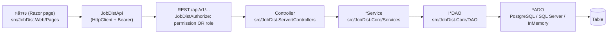

# JobDist: ความสัมพันธ์ หน้าจอ ↔ REST API ↔ Class ↔ Table

ปรับปรุง 27 พฤศจิกายน 2569 · สร้างจากโค้ดจริงใน `src/JobDist.Web/Pages`, `src/JobDist.Web/Services/JobDistApi.cs`, `src/JobDist.Server/Controllers`,
`src/JobDist.Core/Services`, `src/JobDist.Core/DAO`, `src/JobDist.Infrastructure/Data` และ `db/*/schema.sql`
ถ้าเพิ่มหรือแก้หน้าจอ/endpoint ให้แก้ไฟล์นี้ด้วย (ดู [DEVELOPER_GUIDE.md](guides/DEVELOPER_GUIDE.md) หัวข้อ 4)

ลำดับการเรียกของทุกหน้าจอ:

ตัวย่อ route: ทุก route ขึ้นต้นด้วย `/api/v1` (alias `/api` ใช้ได้เหมือนกัน)

## 1. สรุปรายหน้าจอ

| หน้าจอ (route เว็บ) | ไฟล์ | Permission ของหน้า | REST API ที่เรียก | Controller → Service | Table |
|---|---|---|---|---|---|
| ภาพรวมระบบ `/` | `Pages/Dashboard.razor` | `jobdist.dashboard.view` | `GET admin/summary` `GET alerts/queue-status` `GET admin/anomalies` | AdminController → ClusterService QueueThresholdsController → QueueThresholdService AdminController → AnomalyDetectionService | workers, jobs, leaderleases queuethresholds, jobs jobs, jobattempts, workers |
| รายการ Job `/jobs` | `Pages/Jobs/JobList.razor` | `jobdist.job.view` | `GET jobs` `GET jobs/types` `GET workers` | JobsController → JobService JobsController → JobCatalogService WorkersController → WorkerRegistryService | jobs workers, jobs workers, jobs |
| ส่ง Job ใหม่ `/jobs/new` | `Pages/Jobs/JobSubmit.razor` | `jobdist.job.create` | `GET jobs/risk` `POST jobs` `GET jobs/types`, `GET workers` | JobsController → JobRiskService JobsController → JobService (+ QueueThresholdService) | jobs, workers jobs, queuethresholds workers, jobs |
| ส่ง Job จากไฟล์ `/jobs/import` | `Pages/Jobs/JobImport.razor` | `jobdist.job.create` | `POST jobs/batch` | JobsController → JobService | jobs, queuethresholds |
| รายละเอียด Job `/jobs/{id}` | `Pages/Jobs/JobDetail.razor` | `jobdist.job.view` | `GET jobs/{id}` `GET jobs/{id}/attempts` `GET jobs/{id}/risk` `GET workers` | JobsController → JobService JobsController → JobService JobsController → JobRiskService WorkersController → WorkerRegistryService | jobs jobattempts, workers jobs, workers workers |
| เปลี่ยน Priority `/jobs/{id}/edit` | `Pages/Jobs/JobPriority.razor` | `jobdist.job.edit` | `GET jobs/{id}` `PATCH jobs/{id}/priority` | JobsController → JobService | jobs |
| ยกเลิก Job `/jobs/{id}/cancel` | `Pages/Jobs/JobCancel.razor` | `jobdist.job.cancel` | `GET jobs/{id}` `POST jobs/{id}/cancel` | JobsController → JobService | jobs, workercommands |
| รายการ Worker `/workers` | `Pages/Workers/WorkerList.razor` | `jobdist.worker.view` | `GET workers` | WorkersController → WorkerRegistryService | workers, jobs |
| รายละเอียด Worker `/workers/{id}` | `Pages/Workers/WorkerDetail.razor` | `jobdist.worker.view` | `GET workers/{id}` `GET workers/{id}/risk` `GET jobs?workerId=` `GET admin/performance` | WorkersController → WorkerRegistryService WorkersController → JobRiskService JobsController → JobService AdminController → ClusterService | workers, jobs workers, jobs jobs (model ในหน่วยความจำ จาก jobattempts) |
| Drain Worker `/workers/{id}/drain` | `Pages/Workers/WorkerDrain.razor` | `jobdist.worker.drain` | `GET workers/{id}` `POST workers/{id}/drain` | WorkersController → WorkerRegistryService | workers, workercommands |
| ถอด Worker `/workers/{id}/unregister` | `Pages/Workers/WorkerUnregister.razor` | `jobdist.worker.unregister` | `GET workers/{id}` `DELETE workers/{id}` | WorkersController → WorkerRegistryService (+ AlertDispatchService) | workers, jobs, jobattempts, alertoutbox |
| ประสิทธิภาพและคำแนะนำ `/insights/performance` | `Pages/Insights/Performance.razor` | `jobdist.insight.view` | `GET admin/performance` `GET admin/recommendations` `GET jobs/types`, `GET workers` | AdminController → ClusterService AdminController → SchedulerService | (model จาก jobattempts) workers (+ model) |
| ความผิดปกติ `/insights/anomalies` | `Pages/Insights/Anomalies.razor` | `jobdist.insight.view`, ส่ง alert: `jobdist.alert.send` | `GET admin/anomalies` `POST admin/anomalies/alert` | AdminController → AnomalyDetectionService AdminController → AnomalyDetectionService + AlertService → AlertDispatchService | jobs, jobattempts, workers + alertrecipients, alertoutbox |
| รายงานสถิติ Job `/reports/job-statistics` | `Pages/Reports/JobStatistics.razor` | `jobdist.report.view` | `GET reports/job-statistics` `GET jobs/types`, `GET workers` | ReportsController → JobReportService | jobs, jobattempts, workers |
| ผู้รับการแจ้งเตือน `/alerts/recipients` | `Pages/Alerts/RecipientList.razor` | `jobdist.alert.view`, แก้: `jobdist.alert.manage` | `GET alerts/recipients` `DELETE alerts/recipients/{id}` `POST alerts/recipients/{id}/test` | AlertRecipientsController → AlertRecipientService | alertrecipients alertrecipients alertrecipients, alertoutbox |
| ฟอร์มผู้รับ `/alerts/recipients/new`, `/{id}`, `/{id}/edit` | `Pages/Alerts/RecipientForm.razor` | `jobdist.alert.view` / `jobdist.alert.manage` | `GET alerts/recipients/{id}` `POST alerts/recipients` (Idempotency-Key) `PUT alerts/recipients/{id}` `POST .../{id}/test` `GET alerts/channels` | AlertRecipientsController → AlertRecipientService (+ IdempotencyFilter → IdempotencyService) | alertrecipients, idempotencyrecords, alertoutbox (channels มาจาก MessageHub) |
| เกณฑ์คิว `/alerts/queue-thresholds` | `Pages/Alerts/ThresholdList.razor` | `jobdist.alert.view`, แก้: `jobdist.queue.manage` | `GET alerts/queue-thresholds` `GET alerts/queue-status` `DELETE alerts/queue-thresholds/{id}` | QueueThresholdsController → QueueThresholdService | queuethresholds, jobs |
| ฟอร์มเกณฑ์คิว `/alerts/queue-thresholds/new`, `/{id}`, `/{id}/edit` | `Pages/Alerts/ThresholdForm.razor` | `jobdist.alert.view` / `jobdist.queue.manage` | `GET alerts/queue-thresholds/{id}` `POST alerts/queue-thresholds` (Idempotency-Key) `PUT alerts/queue-thresholds/{id}` `GET jobs/types` | QueueThresholdsController → QueueThresholdService JobsController → JobCatalogService | queuethresholds, idempotencyrecords workers, jobs |
| ประวัติการแจ้งเตือน `/alerts/logs` | `Pages/Alerts/AlertLogs.razor` | `jobdist.alert.view` | `GET alerts/logs` | AlertRecipientsController → AlertRecipientService | alertoutbox |
| เข้าสู่ระบบ `/login` | `Pages/Login.razor` (WebCommon `AuthServerAuthClient`) | – | `POST auth/login`, `POST auth/logout`, `POST account/change-password` | YARP proxy → AuthServer `/api/v1/...` | – (ข้อมูลอยู่ใน AuthServer) |
| ผู้ช่วย AI (แผงด้านข้าง) | `Layout` / WebCommon | `jobdist.agent.use` | `GET agent/status` `POST agent/chat` | AgentChatController → AgentChatService → JobDistAiTools (read-only) | ตาม tool ที่เรียก (jobs, workers, ...) |
| ทุกหน้า (log ฝั่งเบราว์เซอร์) | `Services/ClientLogging.cs` | ผู้ใช้ที่ login แล้ว | `POST client-logs` | ClientLogsController → ClientLogForwarder | – (เขียน log → LogServer) |
| หน้าข้อผิดพลาด `/error/{Code}`, `/not-found` | `Pages/ErrorPage.razor`, `Pages/NotFound.razor` | – | – | – | – |

## 2. REST API ↔ Controller ↔ Service ↔ DAO ↔ Table

### 2.1 Jobs (`JobsController`)

| Verb + route | Action | Service.method | DAO | Table |
|---|---|---|---|---|
| `POST jobs` | `Submit` | `JobService.SubmitAsync` (ตรวจ `IQueueAdmission` = QueueThresholdService) | IJobDAO, IQueueThresholdDAO | jobs, queuethresholds |
| `POST jobs/batch` | `SubmitBatch` | `JobService.SubmitBatchAsync` | IJobDAO, IQueueThresholdDAO | jobs, queuethresholds |
| `GET jobs/{jobId}` | `Get` | `JobService.GetAsync` | IJobDAO | jobs |
| `GET jobs` | `List` | `JobService.QueryAsync` | IJobDAO | jobs |
| `GET jobs/{jobId}/attempts` | `Attempts` | `JobService.GetAttemptsAsync` | IJobAttemptDAO, IWorkerDAO | jobattempts, workers |
| `PATCH jobs/{jobId}/priority` | `ChangePriority` | `JobService.ChangePriorityAsync` | IJobDAO | jobs |
| `POST jobs/{jobId}/cancel` | `Cancel` | `JobService.CancelAsync` | IJobDAO, IWorkerCommandDAO | jobs, workercommands |
| `GET jobs/{jobId}/risk` | `Risk` | `JobRiskService.AssessJobAsync` | IJobDAO, IWorkerDAO | jobs, workers |
| `GET jobs/risk` | `SubmissionRisk` | `JobRiskService.AssessSubmissionAsync` | IJobDAO, IWorkerDAO | jobs, workers |
| `GET jobs/types` | `Types` | `JobCatalogService.GetJobTypesAsync` | IWorkerDAO, PendingQueueCache → IJobDAO | workers, jobs |

### 2.2 Workers (`WorkersController`)

| Verb + route | Action | Service.method | DAO | Table |
|---|---|---|---|---|
| `POST workers/register` | `Register` | `WorkerRegistryService.RegisterAsync` (+ alert `WorkerRegistered`) | IWorkerDAO, IAlertOutboxDAO | workers, alertoutbox |
| `DELETE workers/{id}` | `Unregister` | `WorkerRegistryService.UnregisterAsync` (คืนงาน + alert `WorkerUnregistered`) | IWorkerDAO, IJobDAO, IWorkerCommandDAO | workers, jobs, jobattempts, alertoutbox |
| `POST workers/{id}/heartbeat` | `Heartbeat` | `WorkerRegistryService.HeartbeatAsync` | IWorkerDAO, IWorkerCommandDAO | workers, workercommands |
| `POST workers/{id}/poll` | `Poll` | `DispatchService.PollAsync` (ลงนามด้วย PqcSignatureService) | IJobDAO, IWorkerDAO | jobs, workers, workercommands |
| `POST workers/{id}/jobs/{jobId}/started` | `Started` | `JobExecutionService.StartedAsync` | IJobDAO, IJobAttemptDAO | jobs, jobattempts |
| `POST workers/{id}/jobs/{jobId}/completed` | `Completed` | `JobExecutionService.CompletedAsync` (RetryPolicyService) | IJobDAO, IJobAttemptDAO, IWorkerDAO, IWorkerCommandDAO | jobs, jobattempts |
| `GET workers` | `List` | `WorkerRegistryService.ListAsync` | IWorkerDAO, IJobDAO | workers, jobs |
| `GET workers/{id}` | `Get` | `WorkerRegistryService.GetAsync` | IWorkerDAO, IJobDAO | workers, jobs |
| `POST workers/{id}/drain` | `Drain` | `WorkerRegistryService.DrainAsync` | IWorkerDAO, IWorkerCommandDAO | workers, workercommands |
| `GET workers/{id}/risk` | `Risk` | `JobRiskService.AssessWorkerAsync` | IWorkerDAO, IJobDAO | workers, jobs |

### 2.3 Admin (`AdminController`, `KeysController`)

| Verb + route | Action | Service.method | DAO | Table |
|---|---|---|---|---|
| `GET admin/summary` | `Summary` | `ClusterService.GetSummaryAsync` (+ LeaderElectionService) | IJobDAO, IWorkerDAO, ILeaderLeaseDAO | jobs, workers, leaderleases |
| `GET admin/performance` | `Performance` | `ClusterService.GetPerformance` → PerformanceLearningService | – (model ในหน่วยความจำ, ModelTrainer เติมจาก IJobAttemptDAO ทุก 5 นาที) | jobattempts (ทางอ้อม) |
| `GET admin/recommendations` | `Recommend` | `SchedulerService.RecommendAsync` | IWorkerDAO, IJobDAO | workers, jobs |
| `GET admin/anomalies` | `Anomalies` | `AnomalyDetectionService.ScanAsync` | IJobDAO, IJobAttemptDAO, IWorkerDAO | jobs, jobattempts, workers |
| `POST admin/anomalies/alert` | `Alert` | `AnomalyDetectionService.ScanAsync` + `AlertService.NotifyAsync` → AlertDispatchService | + IAlertRecipientDAO, IAlertOutboxDAO | + alertrecipients, alertoutbox |
| `GET keys` | `Get` | `PqcSignatureService.PublicKeys` | – | – |

### 2.4 Alerts, queue limits, reports (`ConsoleControllers.cs`)

| Verb + route | Controller.Action | Service.method | DAO | Table |
|---|---|---|---|---|
| `GET alerts/recipients` | AlertRecipientsController.`List` | `AlertRecipientService.ListAsync` | IAlertRecipientDAO | alertrecipients |
| `GET alerts/recipients/{id}` | `.Get` | `AlertRecipientService.GetAsync` | IAlertRecipientDAO | alertrecipients |
| `POST alerts/recipients` | `.Create` [Idempotent] | `AlertRecipientService.CreateAsync` (PayloadProtectionService เข้ารหัสที่อยู่) | IAlertRecipientDAO, IIdempotencyRecordDAO | alertrecipients, idempotencyrecords |
| `PUT alerts/recipients/{id}` | `.Update` | `AlertRecipientService.UpdateAsync` | IAlertRecipientDAO | alertrecipients |
| `DELETE alerts/recipients/{id}` | `.Delete` | `AlertRecipientService.DeleteAsync` | IAlertRecipientDAO | alertrecipients |
| `POST alerts/recipients/{id}/test` | `.Test` [Idempotent] | `AlertRecipientService.TestAsync` → AlertDispatchService → IAlertDeliveryClient (MessageHub) | IAlertRecipientDAO, IAlertOutboxDAO, IIdempotencyRecordDAO | alertrecipients, alertoutbox, idempotencyrecords |
| `GET alerts/channels` | `.Channels` | `AlertRecipientService.GetChannelsAsync` → MessageHub `GET api/v1/messages/channels` | – | – |
| `GET alerts/event-types` | `.EventTypes` | enum `AlertEventType` | – | – |
| `GET alerts/logs` | `.Logs` | `AlertRecipientService.QueryLogsAsync` | IAlertOutboxDAO | alertoutbox |
| `GET alerts/queue-thresholds` | QueueThresholdsController.`List` | `QueueThresholdService.ListAsync` | IQueueThresholdDAO | queuethresholds |
| `GET alerts/queue-thresholds/{id}` | `.Get` | `QueueThresholdService.GetAsync` | IQueueThresholdDAO | queuethresholds |
| `POST alerts/queue-thresholds` | `.Create` [Idempotent] | `QueueThresholdService.CreateAsync` | IQueueThresholdDAO, IIdempotencyRecordDAO | queuethresholds, idempotencyrecords |
| `PUT alerts/queue-thresholds/{id}` | `.Update` | `QueueThresholdService.UpdateAsync` | IQueueThresholdDAO | queuethresholds |
| `DELETE alerts/queue-thresholds/{id}` | `.Delete` | `QueueThresholdService.DeleteAsync` | IQueueThresholdDAO | queuethresholds |
| `GET alerts/queue-status` | `.Status` | `QueueThresholdService.GetStatusAsync` (PendingQueueCache) | IQueueThresholdDAO, IJobDAO | queuethresholds, jobs |
| `GET reports/job-statistics` | ReportsController.`JobStatistics` | `JobReportService.GetAsync` | IJobReportDAO, IWorkerDAO | jobs, jobattempts, workers |
| `GET agent/status` | AgentChatController.`Status` | `AgentChatService.IsEnabled` | – | – |
| `POST agent/chat` | AgentChatController.`Chat` | `AgentChatService.ChatAsync` → JobDistAiTools | ตาม tool | ตาม tool |
| `POST client-logs` | ClientLogsController.`Post` | `ClientLogForwarder` → ILogger → LogServer | – | – |

### 2.5 MCP (`POST /mcp`, stdio `JobDist.McpServer`)

MCP tools ใน `src/JobDist.Mcp/JobDistAiTools.cs` เรียก Service ชุดเดียวกับ REST:

| Tool | Service | Table |
|---|---|---|
| `get_job_status`, `list_jobs`, `get_job_history` | JobService | jobs, jobattempts, workers |
| `submit_job`, `cancel_job`, `change_job_priority` (side effect) | JobService | jobs, workercommands, queuethresholds |
| `list_workers` | WorkerRegistryService | workers, jobs |
| `get_cluster_summary`, `get_worker_performance` | ClusterService | jobs, workers, leaderleases |
| `recommend_workers` | SchedulerService | workers, jobs |
| `assess_job_risk`, `assess_submission_risk`, `assess_worker_risk` | JobRiskService | jobs, workers |
| `detect_anomalies` | AnomalyDetectionService | jobs, jobattempts, workers |
| `get_queue_status` | QueueThresholdService | queuethresholds, jobs |
| `list_alert_logs` | AlertRecipientService | alertoutbox |
| `get_job_statistics` | JobReportService | jobs, jobattempts, workers |

## 3. งานเบื้องหลัง ↔ Service ↔ Table

ไม่มีหน้าจอเรียกโดยตรง แต่เปลี่ยนข้อมูลที่หน้าจอแสดง

| Background worker | Service | Table ที่อ่าน/เขียน | ผลที่เห็นบนหน้าจอ |
|---|---|---|---|
| LeaderElectionWorker | LeaderElectionService | leaderleases | ภาพรวม: เครื่องหลัก |
| SchedulerWorker (leader) | SchedulerService | jobs, jobattempts, workers | สถานะ Pending → Assigned |
| FailoverWorker (leader) | FailoverService (+ AlertDispatchService) | workers, jobs, jobattempts, alertoutbox | Worker ออฟไลน์, งานกลับเข้าคิว, alert WorkerLost |
| AnomalyMonitorWorker (leader) | AnomalyDetectionService, AlertService | jobs, jobattempts, workers, alertoutbox | alert AnomalyDetected |
| QueueThresholdWorker (leader) | QueueThresholdService | queuethresholds, jobs, alertoutbox | alert QueueNearLimit/OverLimit |
| HousekeepingWorker (leader) | – (IJobDAO) | jobs, jobattempts | งานเก่าหายจากรายการ |
| ConsoleHousekeepingWorker (leader) | IdempotencyService (+ IAlertOutboxDAO) | alertoutbox, idempotencyrecords | ประวัติแจ้งเตือนเก่าถูกลบ |
| ModelTrainingWorker | ModelTrainer → PerformanceLearningService | jobattempts, workers | หน้าประสิทธิภาพ, คะแนน scheduler |
| MetricsGaugeWorker | JobDistMetrics | jobs, workers | metrics เท่านั้น |
| AlertOutboxWorker / RabbitMQ relay + consumer | AlertOutboxProcessor → MessageHubDeliveryClient | alertoutbox, alertrecipients | ประวัติแจ้งเตือน: Sent/Failed |

## 4. ADO ↔ Table

| Implementation (`src/JobDist.Infrastructure/Data`) | Interface | Table |
|---|---|---|
| `WorkerADO.cs` | IWorkerDAO | workers (+ นับงานจาก jobs) |
| `JobADO.cs` | IJobDAO | jobs, jobattempts (assign ใน transaction เดียว) |
| `JobAttemptADO.cs` | IJobAttemptDAO | jobattempts |
| `WorkerCommandADO.cs` | IWorkerCommandDAO | workercommands |
| `LeaderLeaseADO.cs` | ILeaderLeaseDAO | leaderleases |
| `ConsoleADO.cs` → `AlertRecipientADO` | IAlertRecipientDAO | alertrecipients |
| `ConsoleADO.cs` → `AlertOutboxADO` | IAlertOutboxDAO | alertoutbox |
| `ConsoleADO.cs` → `QueueThresholdADO` | IQueueThresholdDAO | queuethresholds |
| `ConsoleADO.cs` → `IdempotencyRecordADO` | IIdempotencyRecordDAO | idempotencyrecords |
| `ConsoleADO.cs` → `JobReportADO` | IJobReportDAO | jobs, jobattempts (อ่านอย่างเดียว) |
| `InMemory/InMemoryADO.cs`, `InMemoryConsoleADO.cs` | ทุก interface | (หน่วยความจำ สำหรับ test) |

แต่ละ ADO มี SQL สองชุด (PostgreSQL และ SQL Server) เลือกตาม `Database:Provider`

## 5. Table ↔ ผู้ใช้ (มุมกลับ)

| Table | หน้าจอที่แสดง/แก้ไข | เขียนโดย |
|---|---|---|
| workers | รายการ/รายละเอียด Worker, Drain, ถอด, ภาพรวม, ตัวเลือก Worker ในฟอร์ม | WorkerRegistryService, FailoverService |
| jobs | ภาพรวม, รายการ/รายละเอียด/ส่ง/นำเข้า/แก้ Priority/ยกเลิก Job, รายงาน | JobService, SchedulerService, DispatchService, JobExecutionService, FailoverService, HousekeepingWorker |
| jobattempts | รายละเอียด Job (ประวัติ), รายงาน, ประสิทธิภาพ, ความผิดปกติ | SchedulerService, JobExecutionService, FailoverService |
| workercommands | – (ส่งให้ Worker ผ่าน heartbeat/poll) | JobService.CancelAsync, WorkerRegistryService.DrainAsync |
| leaderleases | ภาพรวม (เครื่องหลัก) | LeaderElectionService |
| alertrecipients | ผู้รับการแจ้งเตือน | AlertRecipientService |
| alertoutbox | ประวัติการแจ้งเตือน | AlertDispatchService, AlertOutboxProcessor, ConsoleHousekeepingWorker |
| queuethresholds | เกณฑ์คิว, ภาพรวม (สถานะคิว) | QueueThresholdService |
| idempotencyrecords | – (กันกดซ้ำในฟอร์มสร้างข้อมูล) | IdempotencyFilter → IdempotencyService |
