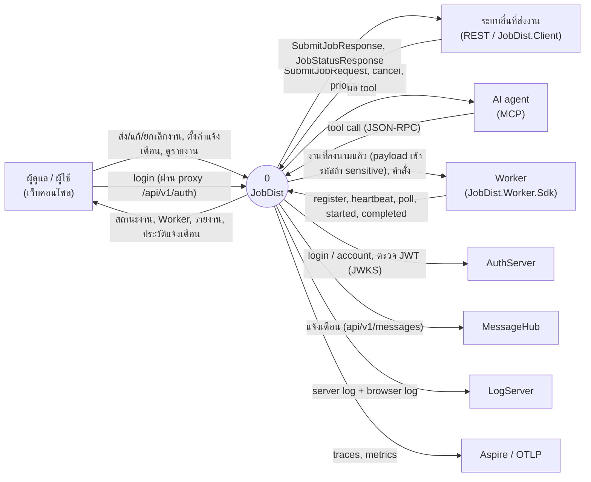
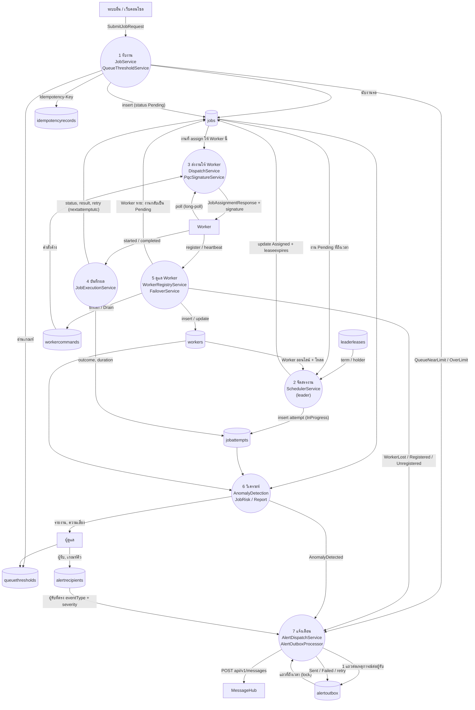
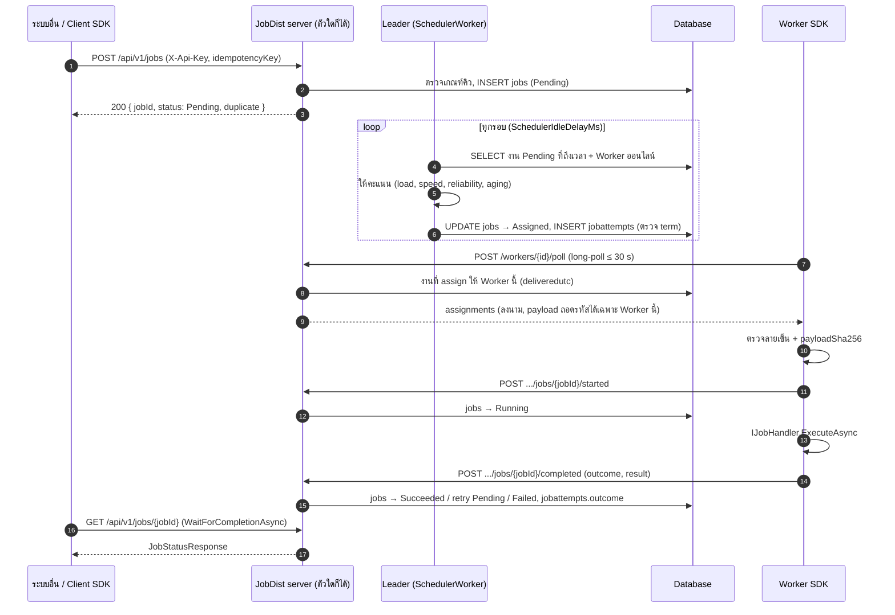
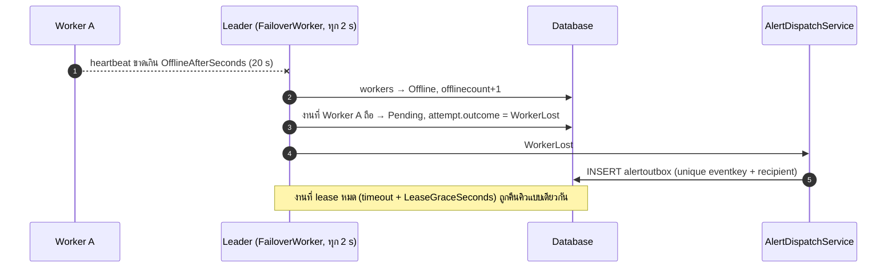
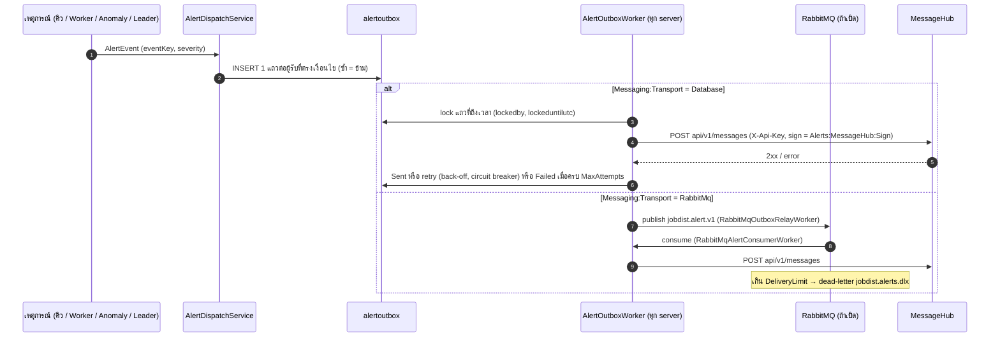
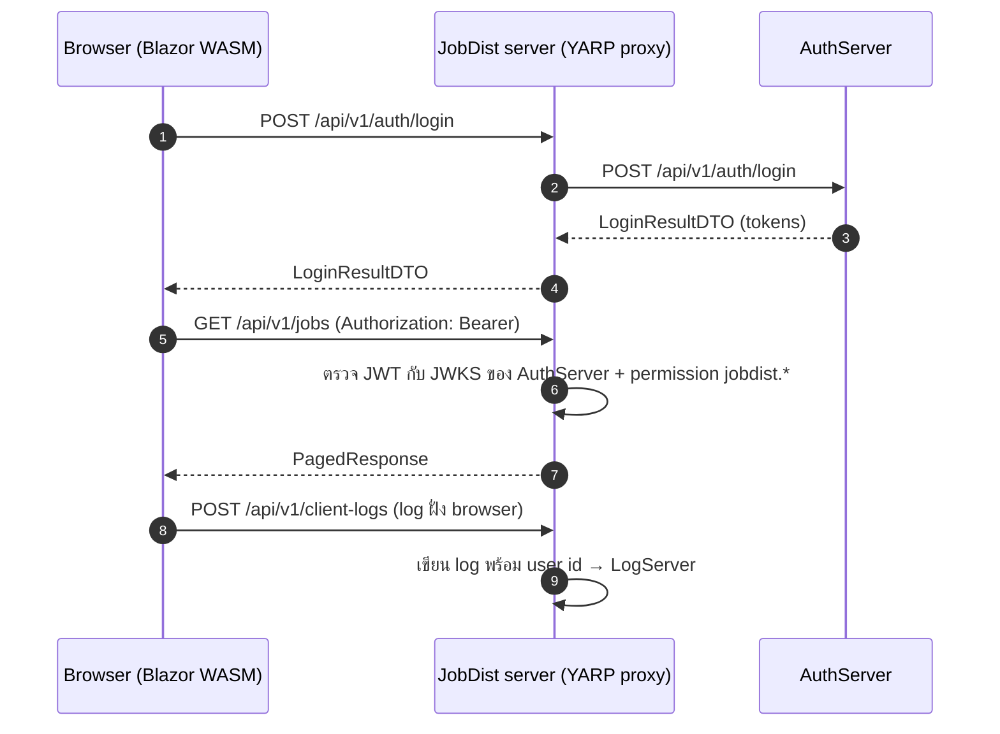

# JobDist: Dataflow Diagram

ปรับปรุง 27 พฤศจิกายน 2569 · ภาพรวมสถาปัตยกรรมดู [ARCHITECTURE.md](../ARCHITECTURE.md), ตารางดู [ER_DIAGRAM.md](ER_DIAGRAM.md)

สัญลักษณ์: สี่เหลี่ยม = ผู้ใช้หรือระบบภายนอก, วงกลม/สี่เหลี่ยมมน = process, ทรงกระบอก = ที่เก็บข้อมูล (ตาราง)

## 1. DFD Level 0 (Context)

## 2. DFD Level 1

| Process | ข้อมูลเข้า | ข้อมูลออก | ตาราง |
|---|---|---|---|
| 1 รับงาน | `SubmitJobRequest`, batch, Idempotency-Key | `SubmitJobResponse`, 429 `queue_full` | jobs, queuethresholds, idempotencyrecords |
| 2 จัดสรรงาน | งาน Pending, Worker ออนไลน์, สถิติประสิทธิภาพ | งาน Assigned + attempt ใหม่ | jobs, jobattempts, workers, leaderleases |
| 3 ส่งงาน | poll ของ Worker | `PollResponse` (งานลงนาม ML-DSA-65 + ECDSA, คำสั่ง) | jobs, workercommands |
| 4 บันทึกผล | started, `JobCompletedRequest` | `JobStatusResponse`, 409 ถ้างานถูกกระจายใหม่แล้ว | jobs, jobattempts |
| 5 ดูแล Worker | register, heartbeat, drain, unregister | token (ครั้งเดียว), คำสั่ง | workers, workercommands, jobs |
| 6 วิเคราะห์ | jobs, attempts, workers | Anomaly, ความเสี่ยง, รายงานสถิติ | jobs, jobattempts, workers |
| 7 แจ้งเตือน | เหตุการณ์จาก 1, 5, 6 และเปลี่ยน leader | ข้อความไป MessageHub, ประวัติ | alertrecipients, alertoutbox |

## 3. ลำดับการทำงานหลัก

### 3.1 ชีวิตของงาน (submit → สำเร็จ)

ถ้างานล้มเหลวแบบลองใหม่ได้และยังไม่ครบ `maxAttempts` สถานะกลับเป็น Pending โดย `nextattemptutc` เลื่อนออกแบบ exponential back-off
(`RetryBaseDelaySeconds` ถึง `RetryMaxDelaySeconds`)

### 3.2 Worker หายและการกระจายงานใหม่

### 3.3 การแจ้งเตือนผ่าน outbox

### 3.4 Login ของเว็บคอนโซล

