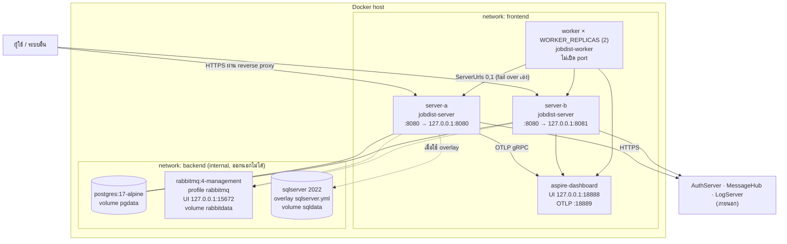
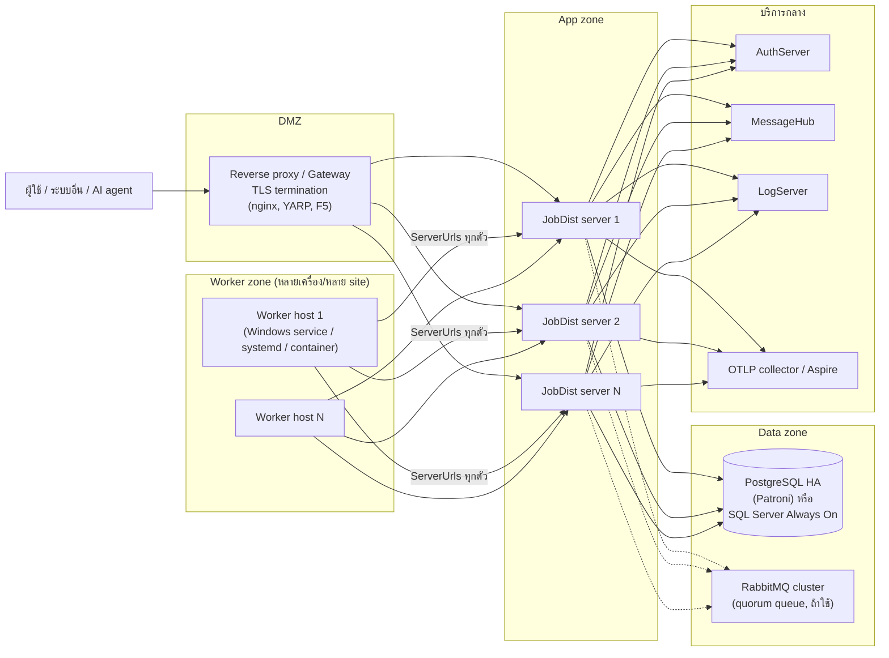

# JobDist: Deployment Diagram

ปรับปรุง 27 พฤศจิกายน 2569 · ที่มา: [`docker-compose.yml`](../../docker-compose.yml), [`docker-compose.sqlserver.yml`](../../docker-compose.sqlserver.yml),
[`docker/Dockerfile.server`](../../docker/Dockerfile.server), [`docker/Dockerfile.worker`](../../docker/Dockerfile.worker) · ขั้นตอนติดตั้งดู [INSTALLATION.md](../manuals/INSTALLATION.md)

## 1. Docker Compose (ชุดที่มากับ repo)

| Service | Image / build | Network | Port บน host | หมายเหตุ |
|---|---|---|---|---|
| `server-a`, `server-b` | `docker/Dockerfile.server` (API + MCP + เว็บคอนโซล) | frontend, backend | `127.0.0.1:8080`, `127.0.0.1:8081` | active-active, `JobDist__InstanceId` ต่างกัน, จำกัด 2 CPU / 1 GB |
| `worker` | `docker/Dockerfile.worker` (sample worker) | frontend | – | replicas `WORKER_REPLICAS` (2), `stop_grace_period` 30 s |
| `postgres` | `postgres:17-alpine` | backend | – | scram-sha-256, healthcheck `pg_isready` |
| `rabbitmq` | `rabbitmq:4-management-alpine` | backend | `127.0.0.1:15672` | เปิดเมื่อ `--profile rabbitmq` และ `MESSAGING_TRANSPORT=RabbitMq` |
| `sqlserver` | `mcr.microsoft.com/mssql/server:2022-latest` | backend | – | แทน postgres เมื่อใช้ `-f docker-compose.sqlserver.yml` |
| `aspire-dashboard` | `mcr.microsoft.com/dotnet/aspire-dashboard` | frontend | `127.0.0.1:18888` | รับ OTLP ด้วย `OTLP_API_KEY`, token เข้า UI อยู่ใน log ของ container |

การ harden ทุก container: non-root, root filesystem อ่านอย่างเดียว, `cap_drop: ALL`, `no-new-privileges`, จำกัด CPU/หน่วยความจำ/pids, `/tmp` เป็น tmpfs,
log หมุนไฟล์ 10 MB × 3, port ผูกกับ `127.0.0.1` เท่านั้น ความลับทั้งหมดมาจาก `.env` (ไม่ commit) และ license DevExpress มาจาก build secret `devexpress_license`

## 2. Production ที่แนะนำ

- **Server**: อย่างน้อย 2 ตัว ทุกตัวรับคำขอได้ (stateless) leader ถูกเลือกผ่านตาราง `leaderleases` ไม่ต้องใช้ sticky session ทุกตัวต้องใช้
  `JobDist:PayloadProtectionKey`, `Crypto:MlDsaPrivateSeed`, `Crypto:EcdsaPrivateKeyPkcs8`, `Crypto:KeyId` ค่าเดียวกัน และ `JobDist:InstanceId` ไม่ซ้ำกัน
- **Worker**: ใส่ URL ของ server ทุกตัวใน `JobDistWorker:ServerUrls` (หรือ URL ของ gateway) Worker ออกทาง outbound อย่างเดียว ไม่ต้องเปิด port ขาเข้า
- **ฐานข้อมูล**: เป็นจุดเดียวที่ต้องทำ HA เอง (replication + failover อัตโนมัติ) และ backup สม่ำเสมอ ดู [OPERATION_GUIDE.md](../guides/OPERATION_GUIDE.md)
- **Gateway**: ส่งต่อ `/api/*`, `/mcp`, `/health`, `/alive` และไฟล์เว็บคอนโซล ตั้ง timeout ของ `POST /api/v1/workers/{id}/poll` ให้มากกว่า 30 วินาที (long-poll)
- **เครือข่ายขาออกของ server**: AuthServer (`AuthServer:Authority`), MessageHub (`Alerts:MessageHub:BaseUrl`), LogServer (`Logging:LogServer:ServerUrls`),
  OTLP endpoint, RabbitMQ (5671/5672) และผู้ให้บริการ AI (เมื่อเปิด `AgentChat`)

## 3. พอร์ตและการเชื่อมต่อ

| จาก | ไป | โปรโตคอล / พอร์ต | ใช้ทำอะไร |
|---|---|---|---|
| ผู้ใช้, ระบบอื่น, Worker, AI agent | JobDist server | HTTPS 443 (gateway) → HTTP 8080 | REST, MCP, เว็บคอนโซล, worker protocol |
| JobDist server | PostgreSQL / SQL Server | TCP 5432 / 1433 | ข้อมูลทั้งหมด |
| JobDist server | RabbitMQ | AMQP 5672 (TLS 5671) | การแจ้งเตือน (ถ้าเปิด) |
| JobDist server | AuthServer | HTTPS | proxy login/account, JWKS |
| JobDist server | MessageHub | HTTPS | ส่งการแจ้งเตือน |
| JobDist server | LogServer | HTTPS | ส่ง log แบบ batch |
| server, worker | OTLP collector | gRPC 4317 (compose ใช้ 18889) | traces และ metrics |

## 4. ตัวเลือกการติดตั้งอื่น

- **ไม่ใช้ Docker**: `dotnet publish src/JobDist.Server -c Release` แล้วรันเป็น Windows Service, systemd หรือ IIS (ASP.NET Core Module) ดู INSTALLATION.md หัวข้อ 8
- **MCP แบบ stdio**: `src/JobDist.McpServer` รันบนเครื่องของผู้ใช้ AI client และต่อฐานข้อมูลเดียวกับ server โดยตรง (เหมาะกับเครื่องในเครือข่ายภายในเท่านั้น)
- **Kubernetes**: ใช้ image เดียวกัน, server เป็น Deployment ≥ 2 replicas + Service, worker เป็น Deployment แยก, ความลับจาก Secret,
  liveness `/alive`, readiness `/health`
