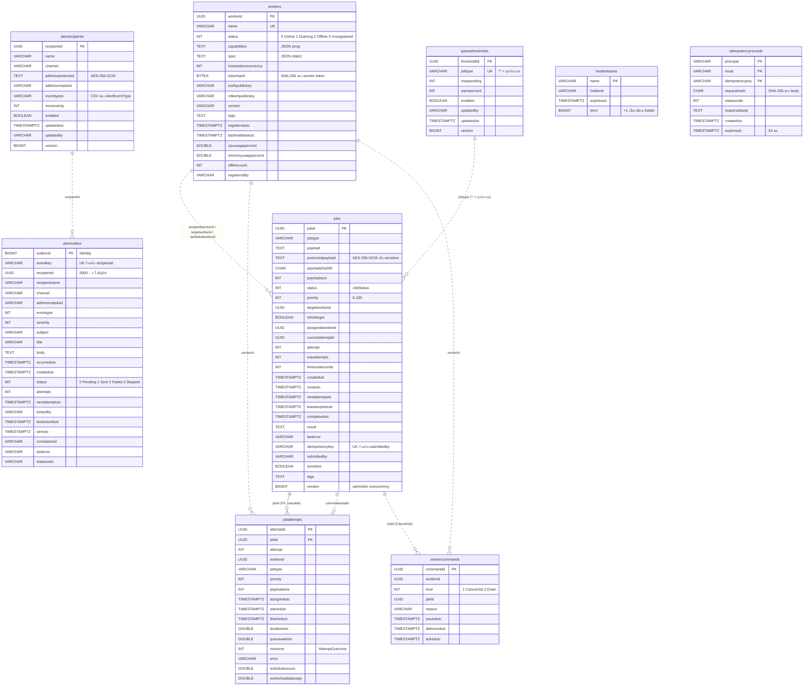

# JobDist: ER Diagram

ปรับปรุง 27 พฤศจิกายน 2569 · ที่มา: [`db/postgres/schema.sql`](../../db/postgres/schema.sql), [`db/sqlserver/schema.sql`](../../db/sqlserver/schema.sql)

ฐานข้อมูลมี 9 ตาราง สร้างเองตอนเริ่มระบบเมื่อ `Database:AutoMigrate=true` (สคริปต์ idempotent รันซ้ำได้)

| PostgreSQL (ตัวเล็ก) | SQL Server (`dbo`, PascalCase) | ใช้ทำอะไร |
|---|---|---|
| `workers` | `dbo.Workers` | เครื่อง Worker ที่ลงทะเบียน, ความสามารถ, สเปก, heartbeat |
| `jobs` | `dbo.Jobs` | งานทุกชิ้นและสถานะปัจจุบัน |
| `jobattempts` | `dbo.JobAttempts` | ประวัติการทำงานแต่ละครั้งของงาน |
| `workercommands` | `dbo.WorkerCommands` | คำสั่งที่ส่งไปให้ Worker (ยกเลิกงาน, Drain) |
| `leaderleases` | `dbo.LeaderLeases` | lease เลือก leader และเลข term สำหรับ fencing |
| `alertrecipients` | `dbo.AlertRecipients` | ผู้รับการแจ้งเตือน (ที่อยู่เข้ารหัส) |
| `alertoutbox` | `dbo.AlertOutbox` | outbox การแจ้งเตือน และประวัติการส่ง |
| `queuethresholds` | `dbo.QueueThresholds` | เกณฑ์คิวต่อประเภทงาน |
| `idempotencyrecords` | `dbo.IdempotencyRecords` | ผลลัพธ์ที่เก็บไว้สำหรับ header `Idempotency-Key` |

Dapper จับคู่ชื่อคอลัมน์กับ property ของ DTO แบบไม่สนตัวพิมพ์ ทั้งสองฐานข้อมูลจึงใช้ DTO ชุดเดียวกัน

## 1. แผนภาพ

มี foreign key จริงเพียงเส้นเดียวคือ `jobattempts.jobid → jobs.jobid` (`ON DELETE CASCADE`) ความสัมพันธ์อื่นเป็นแบบอ้างอิงทางตรรกะ (ไม่มี FK
เพื่อไม่ให้การลบ Worker หรือ housekeeping ล็อกตารางงานที่มีปริมาณสูง) ในแผนภาพเส้นประหมายถึงความสัมพันธ์ทางตรรกะ

แผนภาพแสดงคอลัมน์หลัก ตาราง `jobs` ยังมี `assignedutc`, `deliveredutc`, `startedutc`, `lastdurationms`, `cancelreason`, `lastfailedworkerid` ดูครบใน schema

## 2. Index ที่สำคัญ

| ตาราง | Index | ใช้กับ |
|---|---|---|
| workers | `ux_workers_name` (unique) | ชื่อ Worker ไม่ซ้ำ, ลงทะเบียนซ้ำด้วยชื่อเดิมได้ Worker เดิม |
| workers | `ix_workers_status_heartbeat` | FailoverWorker หา Worker ที่ heartbeat ขาด |
| jobs | `ix_jobs_ready` (`nextattemptutc, priority DESC` where status = Pending) | SchedulerWorker ดึงงานที่พร้อม |
| jobs | `ix_jobs_held` (`assignedworkerid, status`) | งานที่ Worker ถืออยู่, กระจายใหม่เมื่อ Worker หาย |
| jobs | `ix_jobs_lease` | งานที่ lease หมดอายุ |
| jobs | `ux_jobs_idempotency` (unique `submittedby, idempotencykey`) | กันส่งงานซ้ำ (`duplicate: true`) |
| jobs | `ix_jobs_status_type`, `ix_jobs_created`, `ix_jobs_completed` | รายการงาน, นับคิว, รายงาน, housekeeping |
| jobattempts | `ix_jobattempts_job`, `ix_jobattempts_finished` | ประวัติงาน, รายงานสถิติ, anomaly |
| workercommands | `ix_workercommands_pending`, `ix_workercommands_job` | คำสั่งที่ยังไม่ ack ส่งไปกับ heartbeat/poll |
| alertoutbox | `ux_alertoutbox_event` (unique `eventkey, recipientid`) | เหตุการณ์เดียวกันเข้าคิวครั้งเดียวต่อผู้รับ |
| alertoutbox | `ix_alertoutbox_due` (where status = Pending), `ix_alertoutbox_created` | ดึงรายการที่ถึงเวลาส่ง, หน้าประวัติ, housekeeping |
| queuethresholds | `ux_queuethresholds_type` (unique) | 1 เกณฑ์ต่อประเภทงาน |
| idempotencyrecords | PK + `ix_idempotencyrecords_expires` | เล่นซ้ำคำตอบ, ลบเมื่อครบ 24 ชม. |

## 3. ค่า enum ที่เก็บเป็นตัวเลข

| คอลัมน์ | ค่า |
|---|---|
| `jobs.status` | 0 Pending, 1 Assigned, 2 Running, 3 Succeeded, 4 Failed, 5 CancelRequested, 6 Cancelled |
| `jobattempts.outcome` | 0 InProgress, 1 Succeeded, 2 Failed, 3 TimedOut, 4 Cancelled, 5 WorkerLost, 6 Released |
| `workers.status` | 0 Online, 1 Draining, 2 Offline, 3 Unregistered |
| `workercommands.kind` | 1 CancelJob, 2 Drain |
| `alertoutbox.status` | 0 Pending, 1 Sent, 2 Failed, 3 Skipped |
| `alertoutbox.severity`, `alertrecipients.minseverity` | 0 Info, 1 Warning, 2 Critical |

ลำดับค่าต้องตรงกับ enum ใน `JobDist.Contracts` เสมอ ห้ามแทรกค่าใหม่ตรงกลาง (เพิ่มท้ายเท่านั้น และการเพิ่มค่า enum ที่ส่งออกทาง API ถือเป็น breaking change ดู [VERSIONING.md](../VERSIONING.md))

## 4. การเก็บข้อมูลและอายุข้อมูล

- งานที่จบแล้วและ `jobattempts` ลบเมื่อเกิน `JobDist:RetentionDays` (ค่าเริ่มต้น 30 วัน) โดย `HousekeepingWorker` ทุก 1 ชั่วโมง
- `alertoutbox` ลบเมื่อเกิน `Alerts:RetentionDays` (90 วัน) และ `idempotencyrecords` ที่หมดอายุ โดย `ConsoleHousekeepingWorker`
- `workers` ที่ Unregistered ยังเก็บไว้ (ดูได้ด้วย `includeUnregistered=true`)
- ข้อมูลลับ: `jobs.protectedpayload` และ `alertrecipients.addressprotected` เข้ารหัส AES-256-GCM ด้วย `JobDist:PayloadProtectionKey`, `workers.tokenhash` เก็บเฉพาะ SHA-256
